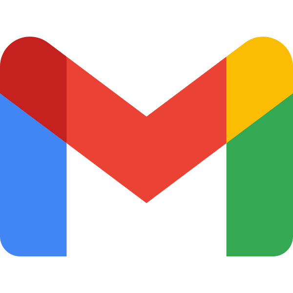

  

   
   - Olá! Sou um estudante no primeiro semestre da faculdade de ADS =)
   - Buscando atuar na área de engenharia de software
   - Atualmente aprofundando meus conhecimentos em C++, C# e HTML/CSS
     
 

  

    
  

  

   
    &nbsp;&nbsp; 
    
    &nbsp;&nbsp;
    
    &nbsp;&nbsp;
       
  

 
           

  

-  gabsaraujo115@gmail.com
-  https://br.linkedin.com/in/gabrielliima
          
 

      
         

